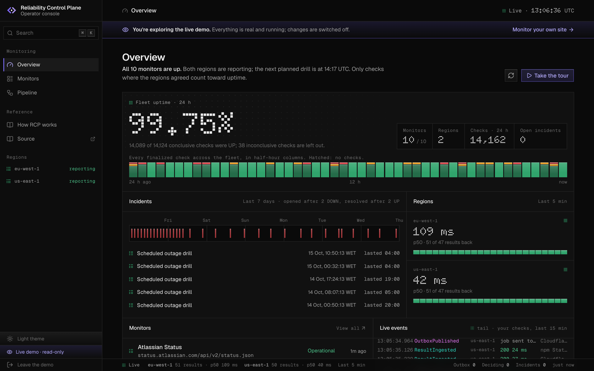
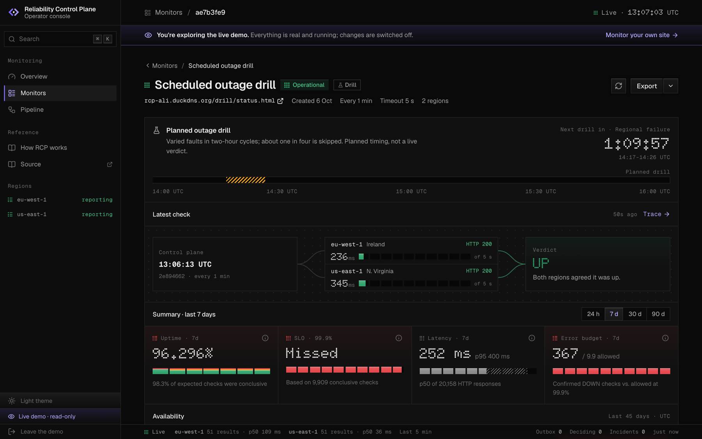
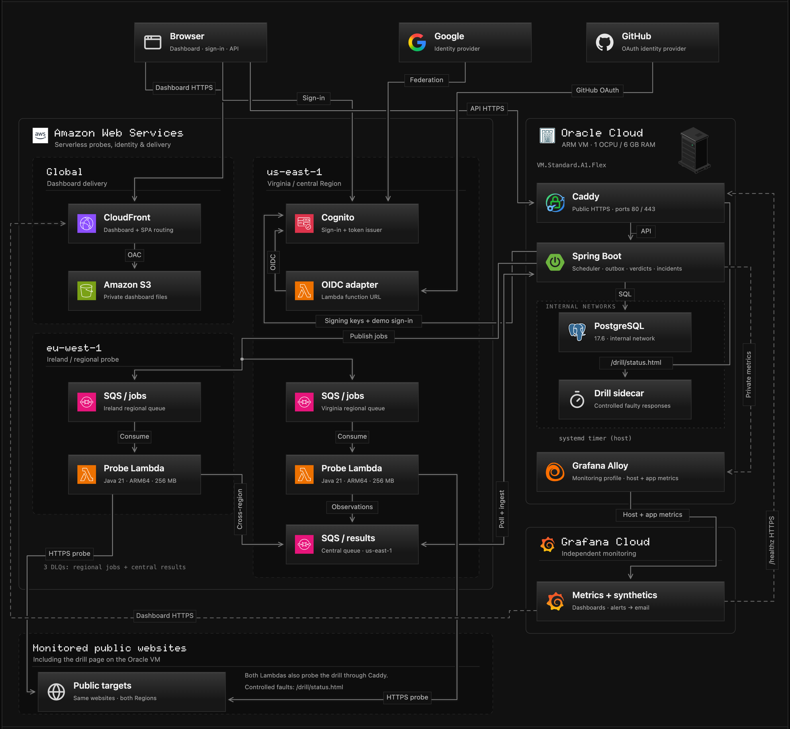
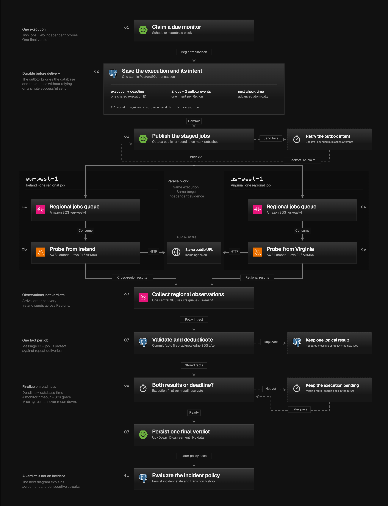
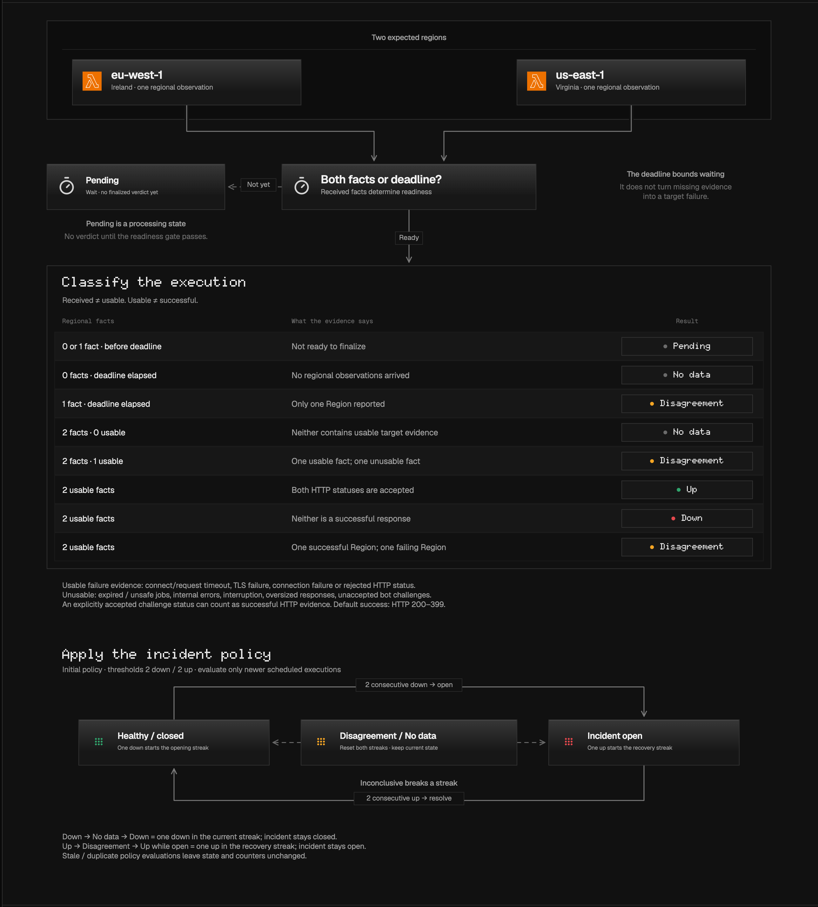
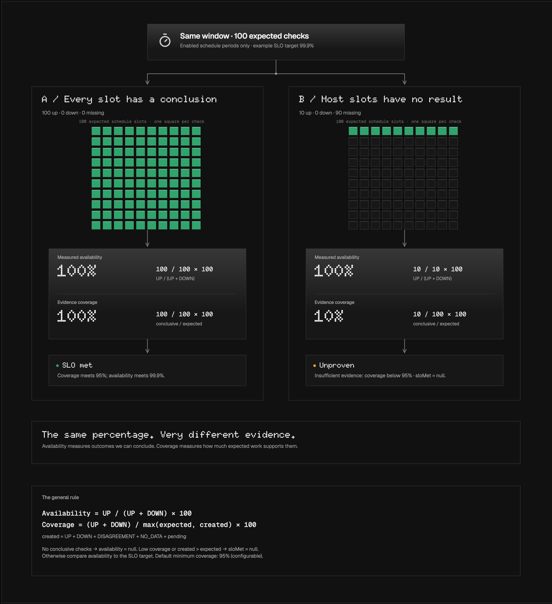

# Reliability Control Plane

Uptime monitoring that checks each site from two AWS regions and only declares an outage when both regions see the
site fail. One region timing out, a probe crashing, or a check that never came back is recorded as *inconclusive*,
not as downtime, so the availability numbers and incidents it reports are backed by evidence.

It is a Java 21 / Spring Boot control plane with PostgreSQL, SQS queues and regional Lambda probe workers, plus a
React operator console and public status pages.

Live demo: <https://d2l2dtbol2pu16.cloudfront.net>. "Try the live demo" opens a read-only workspace with no sign-up. Visitors can also create an account to monitor their own sites, within small per-account limits.



## What it does

- **Monitors HTTP(S) endpoints** on a schedule, each check fanned out to `eu-west-1` and `us-east-1`.
- **Decides per check, across regions.** Both regions get an accepted HTTP response (200–399 by default) → `UP`. Both regions observe a
  target failure (an HTTP error status, a connection or TLS failure, or a timeout) → `DOWN`. Anything else (the
  regions disagree, a region has no answer, a probe was blocked by policy or failed internally) → inconclusive.
- **Lets each monitor choose which HTTP statuses count as up.** The default is 200–399. A custom set is copied
  into each check's execution snapshot when the check is scheduled, so changing it later never reinterprets past
  checks.
- **Treats Cloudflare bot challenges as no evidence.** A response marked `cf-mitigated: challenge` says the probe
  was stopped, not that the target is down. If both regions are challenged the check is shown as *Blocked* (no
  data); if one is, the regions disagree. Challenged responses are left out of latency figures. Accepting the
  challenge status for a monitor (for example 403) overrides this.
- **Opens an incident on the 2nd consecutive `DOWN`** and resolves it after 2 consecutive `UP`s. An inconclusive
  check resets both streaks, so one flaky region can neither open an incident nor close one.
- **Measures availability with its evidence.** Reports show measured availability *and* how much conclusive
  evidence supports it. Coverage is `(UP + DOWN) / max(expected, created)`; below the default 95% threshold,
  with no conclusive checks, or with inconsistent history, the SLO is **Unproven**.
- **Shows its work.** Every check has a trace from scheduled to decided, the console draws the incident state
  machine from the stored streak counters, and a pipeline page shows each stage live.
- **Publishes status pages** with 45 days of history, and owner-only reliability reports over 24 hours, 7, 30 or
  90 days, exported as HTML, JSON, CSV (incidents), or PDF through the browser's print dialog.
- **Soft-deletes monitors.** A deleted monitor disappears from reads, status pages and quotas and stops being
  scheduled, while incident and execution evidence stays in the database.
- **Is careful about what it fetches.** Targets are checked against an SSRF policy: no private or reserved
  addresses, no credentials or query strings, DNS revalidated at connection time, redirects disabled.



The monitor in the screenshot is the **scheduled outage drill** on the live demo: a test endpoint that the server
deliberately faults on a two-hour UTC cycle (outage, slow responses, one-region failure or a short blip, with some
cycles skipped). The schedule is deterministic ([`drill_schedule.py`](deploy/demo/scripts/drill_schedule.py)) and the
fault runs through [`outage-drill.py`](deploy/demo/scripts/outage-drill.py), so incidents open and resolve for real.

## Where RCP runs

The demo configuration combines an Oracle ARM VM with AWS dashboard delivery, identity and two regional probe workers. The local profile uses PostgreSQL and ElasticMQ with workers in one JVM; its Region names are simulation labels.

[](docs/diagrams/deployment.svg)

## The life of one check

One transaction saves an execution, its deadline and two regional outbox intents. Independent workers collect observations; durable ingestion, the deadline and separate policy loops turn them into a decision.

[](docs/diagrams/lifecycle.svg)

## Verdicts and incidents

Received evidence must be usable before it can support UP or DOWN. The initial incident policy needs two consecutive DOWN verdicts to open and two UP to resolve; inconclusive verdicts reset both streaks without changing incident status.

[](docs/diagrams/verdicts.svg)

## Availability needs evidence

A window with 100 UP checks and a window with only 10 UP checks can both report 100% measured availability. Their coverage differs: 100% versus 10%. Insufficient coverage leaves the SLO **Unproven**, rather than declaring a pass or a failure.

[](docs/diagrams/availability.svg)

Each figure links to its full-size SVG. The [interactive diagrams](docs/diagrams/README.md) include flow selection, rule details and calculators; download the HTML files or serve that directory locally.

## Two deployment designs

Geographic probes provide independent target observations; the control plane and its database remain a single
authority. Regions diversify observations, not authority. The repository holds two deployment designs.

**Live demo (running).** The control plane and PostgreSQL run in Docker Compose behind Caddy, which handles HTTPS
certificates automatically, on one Oracle Cloud Always Free ARM VM. Probe Lambdas and SQS job queues run in
`eu-west-1` and `us-east-1`; the results queue and Cognito (Google and GitHub sign-in, plus email) are in
`us-east-1`. The dashboard is served from S3 behind CloudFront. The database is backed up daily, and metrics go to
Grafana Cloud through Alloy. The Lambda and SQS part is modelled at about $2.24/month for ten monitors and $8.96
for forty (ten demo plus thirty visitor monitors) in [`cost-estimate.py`](infra/aws-demo/cost-estimate.py); S3,
CloudFront, logs and the VM are not in that model. A $10/month AWS budget alarm warns about overspend but does not
cap it.

**Production design (Terraform, validated, deliberately not applied).** An ECS Fargate control plane, RDS
PostgreSQL, an Application Load Balancer and two NAT gateways, described in [`infra/aws`](infra/aws/README.md). That
layout has an always-on cost that a demo does not justify, which is why the demo uses the cheaper one.

The figures above describe configuration and application behavior, not a fresh audit of live cloud health.
Deployment instructions live in [the single-server runbook](deploy/demo/README.md), [AWS demo infrastructure](infra/aws-demo/README.md)
and [Oracle infrastructure](infra/oracle-demo/README.md). The shared demo is read-only at the API; visitor
registrations have separate monitor limits.

## Design decisions

Each decision has a full record (context, alternatives, consequences, and when to revisit it) in the
[accepted ADRs](docs/accepted-adrs.md).

| Decision | Why | Trade-off accepted |
| --- | --- | --- |
| **One modular monolith**, not microservices ([ADR-003](docs/accepted-adrs.md#adr-003--modular-monolith)) | One deployable and one transaction boundary; Spring Modulith tests keep the modules separate | Modules must stay disciplined without a network boundary to force it |
| **PostgreSQL is the source of truth**; queues only transport ([ADR-004](docs/accepted-adrs.md#adr-004--postgresql-source-of-truth-and-persistence-split)) | Constraints catch the duplicate and out-of-order messages SQS will deliver | Results are checked against the database instead of trusted from the queue |
| **Scheduling in the database** with `SKIP LOCKED` ([ADR-005](docs/accepted-adrs.md#adr-005--database-due-scheduler)) | Several instances can claim due monitors without double-scheduling, and it is testable locally | More database load than a managed scheduler at very large scale |
| **Transactional outbox** ([ADR-006](docs/accepted-adrs.md#adr-006--transactional-outbox)) | A crash between "saved the job" and "sent it to SQS" can no longer lose work | A job can be sent twice, so every consumer is idempotent |
| **Lambda probes, long-running control plane** ([ADR-008](docs/accepted-adrs.md#adr-008--lambda-probe-workers-and-ecs-control-plane)) | Probes are short and bursty; scheduling and decisions are not | Two runtimes, kept consistent by one shared `rcp-probe-core` module. The live demo runs the same control plane on one VM instead of ECS, for cost |
| **Regions diversify observations, not authority** ([ADR-009](docs/accepted-adrs.md#adr-009--central-region-authority-boundary)) | Two regions buy independent evidence about the target | The control plane itself is single-region; this is not multi-region HA |
| **Inconclusive is not down** | A broken probe or a one-sided failure says nothing reliable about the target | A real outage seen by only one region shows as disagreement, not an incident |
| **Coverage gates the SLO** | 100% availability measured over 3% of the expected checks is not a result | Reports can leave the SLO **Unproven** when evidence is insufficient |
| **Cognito sign-in, read-only enforced on the server** ([ADR-010](docs/accepted-adrs.md#adr-010--oidc-operator-identity)) | No home-made password handling; the demo cannot be changed even with a hand-crafted request | Demo sign-in depends on Cognito being reachable |

## What is proven, and what is not

- **Proven on real AWS:** the live demo has been running since 5 Oct 2026, with probes executing in two real AWS
  regions. The scheduled outage drill opens and resolves incidents end to end there.
- **Proven locally:** the full pipeline with PostgreSQL and an SQS-compatible queue (ElasticMQ), concurrency and
  idempotency under Testcontainers, incident open and resolve through fault injection, a k6 load run, and a
  backup-and-restore exercise. CI runs the Java suite, the dashboard tests, and Terraform formatting and validation. An offline Terraform plan
  has been run by hand, not in CI.
- **Not proven:** the Fargate / RDS production design (it was never applied), network-level egress isolation for
  probes, failover of the control plane,, and production capacity.

The [implementation status](docs/implementation-status.md) is the evidence ledger for every claim, and the
[threat model](docs/threat-model.md) lists the gates that public use still has to meet.

## Tech stack

| Area | Choices |
| --- | --- |
| Backend | Java 21, Spring Boot 4, Spring Modulith, Spring Security (OAuth2 resource server), JPA and JDBC, Flyway |
| Data and messaging | PostgreSQL 17.6, Amazon SQS (ElasticMQ locally) |
| Probes | AWS Lambda (Java 21) around a framework-free probe engine |
| Frontend | React 19, TypeScript, Vite, `oidc-client-ts` |
| Infrastructure | Terraform, Docker, Docker Compose |
| Demo hosting | Oracle Cloud ARM VM with Caddy; AWS Lambda, SQS, Cognito, S3 and CloudFront; Grafana Cloud with Alloy |
| Observability | Micrometer, OpenTelemetry, Prometheus, Grafana, Tempo |
| Testing | JUnit 5, Testcontainers, Vitest with Testing Library, k6 |

## Repository layout

| Path | Contents |
| --- | --- |
| [`rcp-control-plane`](rcp-control-plane) | Spring Boot control plane: API, scheduler, outbox, ingestion, incidents, availability, reports |
| [`rcp-probe-core`](rcp-probe-core) | The probe engine and SSRF policy, shared by every worker |
| [`rcp-probe-lambda`](rcp-probe-lambda) | The regional Lambda worker |
| [`rcp-dashboard`](rcp-dashboard/README.md) | React operator console and public status pages |
| [`infra/aws`](infra/aws/README.md) | Terraform for the separate Fargate / RDS design |
| [`infra/aws-demo`](infra/aws-demo/README.md), [`infra/oracle-demo`](infra/oracle-demo/README.md), [`deploy/demo`](deploy/demo/README.md) | Demo infrastructure and single-server deployment |
| [`docs/screenshots`](docs/screenshots) | Screenshots of the live demo used in this README |
| [`docs/diagrams`](docs/diagrams/README.md) | Four SVG/PNG figures and offline interactive HTML companions |
| [`docs`](docs) | ADRs, implementation status, threat model, runbooks, OpenAPI contract |

## Run it locally

Requirements: Docker Desktop, Java 21 and Node.js. Point `JAVA_HOME` at a Java 21 JDK first; on macOS:

```bash
export JAVA_HOME=$(/usr/libexec/java_home -v 21)
```

Then, from the repository root:

```bash
docker compose up -d
./rcp-control-plane/mvnw -q -DskipTests install
cd rcp-control-plane && RCP_LOCAL_JWT_SECRET="$(openssl rand -base64 48)" ./mvnw spring-boot:run -Dspring-boot.run.profiles=local
```

Then, in a second terminal, start the console and open <http://localhost:5173>:

```bash
cd rcp-dashboard && npm ci && npm run dev
```

The [local development guide](docs/local-development.md) covers the rest: creating monitors with `curl`, fault
drills that open and resolve incidents, tracing with Grafana and Tempo, the k6 load test and the restore exercise.
Run every test with `./rcp-control-plane/mvnw verify` from the repository root.

## Documentation

- [Accepted ADRs](docs/accepted-adrs.md): the decisions above, in full
- [Implementation status](docs/implementation-status.md): what is built and the evidence for it
- [Threat model](docs/threat-model.md): trust boundaries and deployment security gates
- [OpenAPI contract](docs/openapi.yaml): every implemented endpoint
- [Operator runbook](docs/local-operator-runbook.md) and the [fault-drill postmortem](docs/local-fault-drill-postmortem.md)
- [Original architecture plan](docs/architecture-decisions.md): the plan the project started from, not a list of finished features
