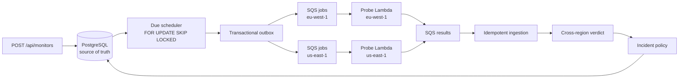
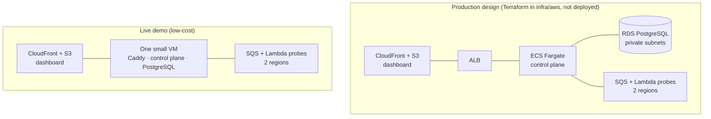

# Reliability Control Plane

Uptime monitoring that checks each site from two AWS regions and only declares an outage when both regions see the
site fail. One region timing out, a probe crashing, or a check that never came back is recorded as *inconclusive*,
not as downtime, so the availability numbers and incidents it reports are backed by evidence.

It is a Java 21 / Spring Boot control plane with PostgreSQL, SQS queues and regional Lambda probe workers, plus a
React operator console and public status pages.

## What it does

- **Monitors HTTP(S) endpoints** on a schedule, each check fanned out to `eu-west-1` and `us-east-1`.
- **Decides per check, across regions.** Both regions succeed → `UP`. Both reach the site and get a failure →
  `DOWN`. Anything else (they disagree, a region has no answer, a probe was blocked by policy) → inconclusive.
- **Opens an incident on the 2nd consecutive `DOWN`** and resolves it after 2 consecutive `UP`s. An inconclusive
  check resets both streaks, so one flaky region can neither open an incident nor close one.
- **Measures availability with its evidence.** Reports show measured availability *and* how many of the expected
  checks actually produced a verdict. Below 95% coverage the SLO result is "insufficient evidence", not a pass.
- **Shows its work.** Every check has a trace from scheduled to decided, the console draws the incident state
  machine from the stored streak counters, and a pipeline page shows each stage live.
- **Publishes status pages** with 45 days of history, and owner-only JSON/HTML reliability reports.
- **Is careful about what it fetches.** Targets are checked against an SSRF policy: no private or reserved
  addresses, no credentials or query strings, DNS revalidated at connection time, redirects disabled.

## How a check flows



PostgreSQL decides what is due and records every outcome; the queues only carry work. Delivery is at least once, so
duplicates are expected and rejected by database constraints rather than prevented.

## Two deployments: the full design and the live demo

The repository describes two AWS setups. They run the same application code and differ only in where the control
plane and database live.



| | Production design | Live demo |
| --- | --- | --- |
| Control plane | ECS Fargate behind an ALB, in a VPC with NAT | One container on a small VM behind Caddy (HTTPS) |
| Database | RDS PostgreSQL in private subnets | PostgreSQL 17.6 on the same VM, with daily dumps |
| Probes, queues, sign-in, dashboard hosting | Lambda in 2 regions, SQS, Cognito, S3 + CloudFront | The same |
| Estimated cost if left running | About $130/month (NAT gateways, ALB, Fargate, RDS) | The VM, plus a few dollars of Lambda time at demo scale |

The demo exists because the production design is too expensive to leave running for a portfolio. Keeping probes,
queues and sign-in on real AWS means the two-region evidence is real; only the always-on pieces moved.

### Trying the demo

The sign-in page offers **Try the live demo**: a shared, read-only account with a few neutral monitors already
running. Read-only is enforced by the API (a Cognito `demo` group), not just hidden buttons, and the demo password
never reaches the browser because the backend signs in on the visitor's behalf. Anyone can also **create an
account** to monitor their own site, within deployment-wide limits on interval, timeout and monitor count.

## Design decisions

Each decision has a full record (context, alternatives, consequences, and when to revisit it) in the
[accepted ADRs](docs/accepted-adrs.md).

| Decision | Why | Trade-off accepted |
| --- | --- | --- |
| **One modular monolith**, not microservices ([ADR-003](docs/accepted-adrs.md#adr-003--modular-monolith)) | One deployable and one transaction boundary; Spring Modulith tests keep the modules separate | Modules must stay disciplined without a network boundary to force it |
| **PostgreSQL is the source of truth**; queues only transport ([ADR-004](docs/accepted-adrs.md#adr-004--postgresql-source-of-truth-and-persistence-split)) | Constraints catch the duplicate and out-of-order messages SQS will deliver | Results are checked against the database instead of trusted from the queue |
| **Scheduling in the database** with `SKIP LOCKED` ([ADR-005](docs/accepted-adrs.md#adr-005--database-due-scheduler)) | Several instances can claim due monitors without double-scheduling, and it is testable locally | More database load than a managed scheduler at very large scale |
| **Transactional outbox** ([ADR-006](docs/accepted-adrs.md#adr-006--transactional-outbox)) | A crash between "saved the job" and "sent it to SQS" can no longer lose work | A job can be sent twice, so every consumer is idempotent |
| **Lambda probes, long-running control plane** ([ADR-008](docs/accepted-adrs.md#adr-008--lambda-probe-workers-and-ecs-control-plane)) | Probes are short and bursty; scheduling and decisions are not | Two runtimes, kept consistent by one shared `rcp-probe-core` module |
| **Regions diversify observations, not authority** ([ADR-009](docs/accepted-adrs.md#adr-009--central-region-authority-boundary)) | Two regions buy independent evidence about the target | The control plane itself is single-region; this is not multi-region HA |
| **Inconclusive is not down** | A broken probe or a one-sided failure says nothing reliable about the target | A real outage seen by only one region shows as disagreement, not an incident |
| **Coverage gates the SLO** | 100% availability measured over 3% of the expected checks is not a result | Reports can say "insufficient evidence" instead of giving a number |
| **Cognito sign-in, read-only enforced on the server** ([ADR-010](docs/accepted-adrs.md#adr-010--oidc-operator-identity)) | No home-made password handling; the demo cannot be changed even with a hand-crafted request | The live demo depends on Cognito being reachable |

## What is proven, and what is not

- **Proven locally:** the full pipeline with PostgreSQL and an SQS-compatible queue (ElasticMQ), concurrency and
  idempotency under Testcontainers, incident open and resolve through fault injection, a k6 load run, and a
  backup-and-restore exercise. CI runs the Java suite, the dashboard tests and an offline Terraform plan.
- **Not proven:** real-AWS behaviour of the production design (it has never been applied), network-level egress
  isolation for probes, failover of the control plane, and production capacity.

The [implementation status](docs/implementation-status.md) is the evidence ledger for every claim, and the
[threat model](docs/threat-model.md) lists the gates that public use still has to meet.

## Tech stack

| Area | Choices |
| --- | --- |
| Backend | Java 21, Spring Boot 4, Spring Modulith, Spring Security (OAuth2 resource server), JPA and JDBC, Flyway |
| Data and messaging | PostgreSQL 17.6, Amazon SQS (ElasticMQ locally) |
| Probes | AWS Lambda (Java 21) around a framework-free probe engine |
| Frontend | React 19, TypeScript, Vite, `oidc-client-ts` |
| Infrastructure | Terraform, Docker, Docker Compose |
| Observability | Micrometer, OpenTelemetry, Prometheus, Grafana, Tempo |
| Testing | JUnit 5, Testcontainers, Vitest with Testing Library, k6 |

## Repository layout

| Path | Contents |
| --- | --- |
| [`rcp-control-plane`](rcp-control-plane) | Spring Boot control plane: API, scheduler, outbox, ingestion, incidents, availability, reports |
| [`rcp-probe-core`](rcp-probe-core) | The probe engine and SSRF policy, shared by every worker |
| [`rcp-probe-lambda`](rcp-probe-lambda) | The regional Lambda worker |
| [`rcp-dashboard`](rcp-dashboard/README.md) | React operator console and public status pages |
| [`infra/aws`](infra/aws/README.md) | Terraform for the production design (validated offline, never applied) |
| [`docs`](docs) | ADRs, implementation status, threat model, runbooks, OpenAPI contract |

## Run it locally

Requirements: Docker Desktop, Java 21 and Node.js. From the repository root:

```bash
docker compose up -d
JAVA_HOME=$(/usr/libexec/java_home -v 21) ./rcp-control-plane/mvnw -q -DskipTests install
cd rcp-control-plane && RCP_LOCAL_JWT_SECRET="$(openssl rand -base64 48)" ./mvnw spring-boot:run -Dspring-boot.run.profiles=local
```

Then, in a second terminal, start the console and open <http://localhost:5173>:

```bash
cd rcp-dashboard && npm install && npm run dev
```

The [local development guide](docs/local-development.md) covers the rest: creating monitors with `curl`, fault
drills that open and resolve incidents, tracing with Grafana and Tempo, the k6 load test and the restore exercise.
Run every test with `./rcp-control-plane/mvnw verify` from the repository root.

## Documentation

- [Accepted ADRs](docs/accepted-adrs.md): the decisions above, in full
- [Implementation status](docs/implementation-status.md): what is built and the evidence for it
- [Threat model](docs/threat-model.md): trust boundaries and deployment security gates
- [OpenAPI contract](docs/openapi.yaml): every implemented endpoint
- [Operator runbook](docs/local-operator-runbook.md) and the [fault-drill postmortem](docs/local-fault-drill-postmortem.md)
- [Original architecture plan](docs/architecture-decisions.md): the plan the project started from, not a list of finished features
