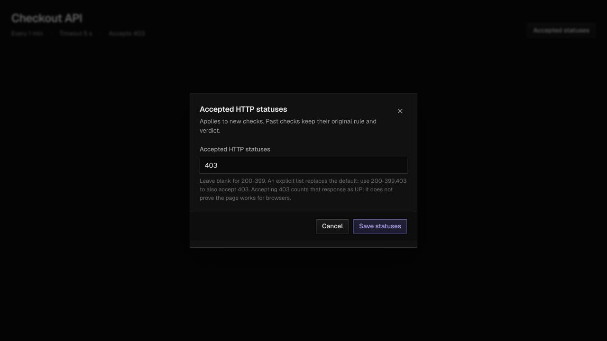

# Monitor lifecycle and response rules

## Delete a monitor

Owners can delete a monitor from its detail page after typing its name. The API is `DELETE /api/monitors/{id}`: success is 204; foreign, missing or already deleted IDs return 404. The demo role cannot mutate monitors.

Deletion uses a tombstone, not a cascade. PostgreSQL foreign keys preserve incident anchors and execution evidence, while every owner read, public status page and pipeline count excludes the monitor. It stops consuming both quotas, its schedule closes and its public-page memberships are removed in the same transaction. There is no restore API, and deletion is not a promise to erase stored data.

The scheduler and deletion take the monitor's write lock; ingestion takes its shared lock. Results stored before deletion become hidden with the monitor. Results arriving after deletion are acknowledged, logged as `DISCARDED_MONITOR` and not stored. Unpublished outbox events are cancelled. A publisher that already took a job may still send it, but its late result is discarded. Deletion never locks an execution row, avoiding an inversion with incident evaluation's execution-then-monitor lock order.

Normal retention removes old check evidence, including abandoned executions of deleted monitors, and old cancelled outbox entries. Incident anchors, the last evaluated execution and monitor tombstones remain for referential integrity. Operators should not use this endpoint as a data-erasure operation.

## Accepted HTTP statuses

The default is 200 through 399. A custom set replaces the default:

- `403` accepts only 403.
- `200-399,403` accepts the normal range plus 403. The UI expands ranges to integer codes before sending them.
- Empty UI input or `"acceptedHttpStatuses": null` resets the default.

Create accepts the optional `acceptedHttpStatuses` field. `PATCH /api/monitors/{id}` changes only that field and requires it to be present. Sets must be nonempty, contain at most 500 entries, and contain integers from 100 through 599; duplicates are normalized and codes sorted. The exact default range is stored as null.

Scheduling copies the rule into `probe_executions.accepted_http_statuses_snapshot`. Finalization uses this snapshot, not the monitor's current setting. Historical verdicts, availability, SLO calculations and report exports therefore survive later edits. Latest-check, regional-result and trace colours also use the relevant check's snapshot. Editing the rule starts a new behavior version: an old in-flight check retains its verdict, but cannot carry its streak into the new incident run. Existing open incidents remain and require fresh successful checks to resolve.

Accepting 403 changes what UP means for that monitor: it proves an accepted response was received, not that a protected page is usable by browsers.

## Bot-protection hints

Probes record the known `cf-mitigated: challenge` marker as optional `botProtection: "CLOUDFLARE_CHALLENGE"` metadata. They do not infer it from 403, parse HTML, persist other headers, bypass challenges or change verdicts. A 403 stays DOWN under the default rule. Both the latest-check view and trace explain the marker and suggest reviewing accepted statuses or choosing a health endpoint.

The result-message schema stays at version 1. New receivers accept messages without the optional field. New senders omit it when absent. Deploy the receiver first: a previously deployed strict receiver may reject the new field when a challenge occurs. Older results never gain a guessed hint. JSON history and trace expose the metadata; the aggregate HTML report and incident CSV remain unchanged.

## Release order after review

Incident evaluation locks an execution with `FOR NO KEY UPDATE`, then locks its live monitor.
The weaker execution lock still serializes evaluators but permits the foreign-key key-share
lock taken when a late probe result is inserted. Result ingestion can therefore finish and
release its monitor share lock instead of deadlocking with incident evaluation. A concurrent
integration test exercises both real repository paths and keeps finalized verdicts unchanged.

These are operator instructions, not actions performed by this PR. Back up first, then deploy the backend before updated probes or dashboard assets. Do not roll back to a pre-migration binary after deletion: it cannot recognize tombstones. A rollback needs a compatible binary or an intentional database restore.

On the VM, for the deployment with Grafana enabled:

```sh
cd /opt/rcp
bash deploy/demo/scripts/backup.sh
git pull --ff-only
cd deploy/demo
docker compose --env-file .env --env-file .env.monitoring --profile monitoring config --quiet
docker compose --env-file .env --env-file .env.monitoring --profile monitoring build control-plane
docker compose --env-file .env --env-file .env.monitoring --profile monitoring up -d --no-deps --force-recreate control-plane
docker compose --env-file .env --env-file .env.monitoring --profile monitoring ps
curl --fail https://rcp-ali.duckdns.org/healthz
```

The default deployment without Grafana uses the same `build` and `up` commands without the two `--env-file` options and `--profile monitoring`. Recreating the container also reloads file-mounted settings. Flyway applies V11–V13 on startup; PostgreSQL and Caddy need no restart.

Build the reviewed probe revision locally, prepare a Terraform plan using the existing private demo configuration, and review it before any apply:

```sh
JAVA_HOME=$(/usr/libexec/java_home -v 21) ./rcp-control-plane/mvnw -f pom.xml -pl rcp-probe-lambda -am verify
terraform -chdir=infra/aws-demo plan -out=probe-hint.tfplan
```

The probe package must include any other probe changes merged meanwhile. Confirm the plan updates the intended probe artifacts/functions without unrelated resource creation, replacement or deletion; deployment still requires explicit operator approval. This PR does not run the plan or apply. Accepted statuses and deletion work with older probes; only challenge hints require the new probes.

Publish the dashboard using the existing private build variables and the [dashboard upload procedure](../infra/aws-demo/README.md). Backend first ensures the delete/edit endpoints exist before the new controls are visible.

Smoke-test using a disposable monitor owned by a regular account: customize its statuses, inspect the saved rule in a trace, reset the default, then confirm deletion. Verify its list, quota and public status-page membership, and that a demo login has neither mutation action. A controlled 403 response with `cf-mitigated: challenge` tests the hint without relying on a third-party site's behavior.

## UI preview

Local fixture showing the existing design's status editor; it is not a production screenshot.


