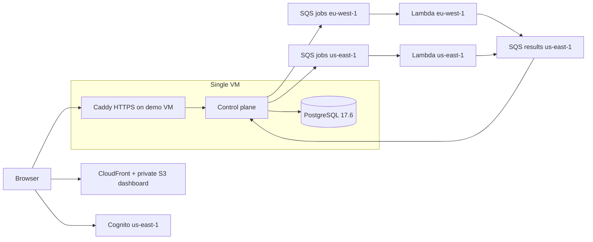

# Low-cost AWS demo infrastructure

This is a separate Terraform root and state from `../aws/`. It builds the AWS half
of a demo; the control plane and PostgreSQL run on one external VM using
[`deploy/demo`](../../deploy/demo/README.md). It creates no VPC, NAT gateway,
ALB, ECS service, RDS instance, EC2 instance, or paid DNS zone.



Production retains its separate multi-AZ network, NAT gateways, ALB, ECS, and RDS.
The demo gives up database HA and managed VM operations to avoid those fixed
costs. Local validation proves configuration, not AWS deployment or availability.

## Contract

- Cognito is in **us-east-1**; self sign-up and email-code verification are enabled.
  Essentials tier (Lite does not support refresh-token rotation; both are free up to
  10,000 monthly active users), the production password policy, and optional TOTP are explicit.
- A public OAuth client uses authorization code flow; the browser supplies PKCE.
  The backend may use `ADMIN_USER_PASSWORD_AUTH` via its IAM user for the demo
  button. Refresh-token rotation is enabled; the incompatible
  `ALLOW_REFRESH_TOKEN_AUTH` flow is omitted.
- Group `demo` is a label. Backend enforcement of read-only access is required;
  Terraform does not grant application permissions.
- Cognito callback is the generated CloudFront origin plus `/auth/callback`.
  Logout uses the origin **without a trailing slash**, matching the current SPA.
- The shared demo user and server IAM access key are created by an operator outside
  Terraform. No password, access-key secret, or demo account goes into its state.
- Probes run in **eu-west-1** and **us-east-1**, with central results in us-east-1.
  Source queues and workers share a region. Each queue has a restricted DLQ.
- Runtime IAM: send only to two job queues; receive/delete/change visibility/read
  attributes only on the result queue; `AdminInitiateAuth` only on this user pool.
- The output `server_application_json` preserves the region keys exactly. It also
  wires 5 monitors/owner, 60-second minimum interval, 30 monitors globally, demo
  group enforcement, and a 5,000 ms maximum timeout. `rcp.demo.monitors` seeds
  Example Domain, Wikipedia, Scheduled outage drill, GitHub Status and Cloudflare
  Status for the shared account, and
  `rcp.demo.example-monitor-url=https://example.com` enables one-time onboarding.
  Provisioning captures the Cognito UUID `sub` in a host file supplied through
  `RCP_DEMO_OWNER_SUBJECT`; an email/username is not a valid substitute. Deploy an
  application release that supports these properties and enforces the limits.
- Lambda uses Java 21/ARM64/256 MiB, 30-second timeout, one job per invocation,
  a maximum of ten SQS invocations per region, and partial failures.
  The current handler is sequential, and scheduled jobs have a 30-second result
  grace period. Larger batches can consume that grace while later records wait.
  The concurrency limit provides burst capacity for the eight-monitor cap; measure
  cold starts, peak memory and end-to-end lateness after deployment. Lambda CPU
  scales with memory, so 256 MiB is a starting configuration, not a proven optimum.
  Raise it to 512 MiB if live measurements show memory pressure or late probes,
  updating the plan checker and cost model together. Reserved concurrency is off
  by default: new AWS accounts can have reduced regional quotas, and AWS requires
  100 slots to remain unreserved. Verify each region's capacity before opting into
  `reserve_probe_concurrency=true` (ten reserved slots/region). The SQS maximum of
  ten remains enforced without reservation; there is no function URL or second
  event source. Account contention can still throttle workers.
- Job visibility is 180 seconds (6 × Lambda timeout), result visibility 60 seconds,
  long polling 20 seconds, max receives 5, Lambda logs retained 3 days. No active
  X-Ray sampling or provisioned Lambda/SQS polling capacity is configured.
- CloudFront rewrites SPA routes to `index.html` at viewer request time. Missing
  `/assets/` objects keep their error instead of returning HTML. Private S3 access
  uses OAC; a zero minimum cache TTL allows `index.html` to be uploaded uncached.

## Optional Google and GitHub sign-in

Sign-up and password-reset codes use the branded HTML in `email/verification.html`
(one `{####}` placeholder, under Cognito's 20,000 character limit; `check_plan.py`
verifies both). They are still sent by Cognito's default sender, which some providers
file under spam. The fix is Amazon SES with a verified domain and DKIM; it is a later
step because there is no domain yet.

Off by default: with `social_providers = []` nothing below exists and no secrets are
needed. Turning it on adds identity providers to the Cognito pool and lists them on
the dashboard app client. The dashboard starts sign-in through Cognito's
`/oauth2/authorize` with `identity_provider=Google` or `identity_provider=GitHub`;
the `VITE_SOCIAL_PROVIDERS` build variable lists the enabled names.

1. Get the redirect URI from `terraform output social_sign_in`. It is
   `https://<domain>.auth.us-east-1.amazoncognito.com/oauth2/idpresponse`, built from
   the pool domain (`rcp-demo-<account id>` by default), so you can also write it down
   before the first apply.
2. **Google:** in Google Cloud Console create an OAuth client of type *Web application*.
   Add the redirect URI above as an authorized redirect URI and the dashboard origin
   (`dashboard.origin`, the CloudFront URL) as an authorized JavaScript origin.
3. **GitHub:** in Developer settings create an *OAuth App*. Set its callback URL to the
   same redirect URI. Cognito never talks to GitHub directly: GitHub OAuth is not OIDC,
   so a small Node.js 22 Lambda in `github-oidc/` (function URL, no npm dependencies)
   adds the missing discovery document, `id_token` and JWKS. Its RS256 signing key is a
   Terraform `tls_private_key` passed to the Lambda as an encrypted environment
   variable (SSM is not used: the region policy does not allow it). Only an account with a
   primary **verified** email can sign in.
4. Put the four values in the ignored `terraform.tfvars` (see the example file):
   `google_client_id`, `google_client_secret`, `github_client_id`,
   `github_client_secret`, and set `social_providers = ["Google", "GitHub"]` (or one).
5. Review the plan with the operator and apply. Rebuild the dashboard with the new
   `VITE_SOCIAL_PROVIDERS` value.

The signing key is the one generated secret. It lives in Terraform state and in the
function's environment, which Lambda encrypts at rest with the AWS-managed key; anyone
with `lambda:GetFunctionConfiguration` can read it, so the protected state store described
below matters. It is never logged. The adapter function URL is public by
design (it is the OIDC issuer Cognito reads), is capped at 256 MiB and a 10-second
timeout, and reserves 5 concurrent slots only when `reserve_probe_concurrency=true`.
Its logs keep 14 days and never include codes or tokens. People who sign in with a
provider are separate Cognito users from password users, even with the same email.
Cost is a few Lambda invocations per sign-in; it is not part of `cost-estimate.py`.

**Why our own adapter.** The usual answer to "GitHub with Cognito" is
[github-cognito-openid-wrapper](https://github.com/TimothyJones/github-cognito-openid-wrapper),
which does the same job: it wraps GitHub OAuth in the OIDC endpoints Cognito expects. We
wrote a small one instead because the wrapper ships its own SAM/CloudFormation stack, older
Node runtimes and a dependency tree to keep patched, while ours is one file with no npm
dependencies, deployed and reviewed with the rest of this Terraform, and covered by
`node --test` (`github-oidc/index.test.mjs`): discovery, the authorize redirect, the token
exchange with Basic or form client credentials, the verified-email rule, and JWKS/`id_token`
signature checks.

## Validate without AWS credentials or resources

Run from the repository root:

```sh
./infra/aws-demo/validate.sh
```

This runs format checks, provider initialization with the committed lockfile,
validation, and a plan using fake variables and fake credentials. It isolates the
plan from deployed state, disables provider identity lookups, and checks the plan
for excluded resource types, region placement, IAM actions, and runtime settings.
It then plans again with both social providers enabled (fake client IDs and secrets),
applies the same checks, and runs the sign-in adapter's `node --test` suite (Node 22).
Provider downloads contact the Terraform registry; AWS APIs are not needed.
Never apply a plan made with `offline_mode=true`.

The existing repository CI validates `infra/aws/` only. Until a separately approved
workflow change adds this folder, run this validation explicitly. The lockfile
includes provider checksums for Linux and both Mac architectures.

## Later deployment sequence (requires account and deployment authorization)

1. Create the AWS account and an account-wide **$1 monthly budget alert before
   any application resources**. AWS Budgets alerts lag usage and do not cap
   spending. The budget resource here maintains matching alerts at 10% actual,
   100% actual, and 100% forecast; credits/refunds are excluded so credits do not
   hide consumption. An existing budget can be imported by an operator, or use
   the matching name when creating it. This root does not enforce resource
   creation ordering; a full apply is not a substitute for the initial alarm.
2. Verify expired-session handling, the read-only backend role, demo login,
   quotas, and seeding using the generated application configuration. This root
   supplies `rcp.monitors.max-timeout-ms=5000`; verify the backend enforces it.
3. Build and verify the shaded probe artifact with Java 21:

   ```sh
   JAVA_HOME=$(/usr/libexec/java_home -v 21) ./rcp-control-plane/mvnw -pl rcp-probe-lambda -am verify
   ```

   On Linux, set Java 21 using the server/CI runtime rather than the macOS helper.
   This creates `rcp-probe-lambda/target/rcp-probe-lambda.jar`. The same JAR is uploaded
   to separate private, versioned buckets in each region; Lambda's artifact bucket
   must be in its own region. Old artifact versions expire after 7 days.
4. Copy `terraform.tfvars.example` to the ignored `terraform.tfvars`, set the real
   account ID, notification email, API HTTPS origin, and a unique name. Keep the
   name distinct from production. Use deployment credentials, never the runtime
   IAM user. `offline_mode` must be false; the provider rejects other accounts.
5. Review a real plan with the operator, then deploy only after authorization.
   Do not reuse an offline plan. The central resources are us-east-1; the second
   provider handles only the Europe worker and job queues.
6. Export `terraform output -json` to a private file and follow the VM runbook.
   The outputs include identity, queues/DLQs, dashboard build variables, the
   runtime username, and nonsecret Spring JSON. Configure and smoke-test the
   backend before publishing the dashboard.
7. Upload the dashboard's hashed assets with long immutable cache headers and
   `index.html` with `Cache-Control: no-cache,max-age=0,must-revalidate`; invalidate
   `/index.html` after a release. Do not upload credentials or `.env` files.

## Cost model and limits

**Low-cost does not mean always free.** Check the actual account's eligibility,
current regional prices, and usage shared with other projects. Credits are
finite; free-tier allowances are account-wide and not doubled by two regions.

Estimate both Lambda requests and GB-seconds. At 8 monitors (the original demo size; the cap is now 30),
60 seconds, two regions and 30 days, the configured one-job batches produce
691,200 checks/invocations before retries. Average billed duration must include
probe time, DNS/TLS setup, result publishing, cold starts, and failures.

`cost-estimate.py` is an explicit illustrative model, not a worst-case ceiling. It accepts 0 to 30
monitors (the demo's global cap), takes the average billed duration as `--duration-ms` (default 500, printed as
an assumption), and prints what it includes (Lambda requests and GB-seconds, SQS requests) and what it does not
model (CloudWatch Logs, cross-region data transfer, S3 and CloudFront, Cognito, budget services, VM and domain).
It defaults to to 256 MiB, ARM duration
at $0.0000133334/GB-second, requests at $0.20/million, standard SQS at $0.40/million,
and available account-wide allowances of 1M Lambda requests, 400k GB-seconds and
1M SQS requests. It conservatively counts six SQS calls/check plus up to five idle
pollers per region and one result consumer at 20 seconds. Actual receive/delete
batching and busy/idle overlap change this; retries increase it.

```sh
python3 infra/aws-demo/cost-estimate.py --monitors 8 --duration-ms 500
python3 infra/aws-demo/cost-estimate.py --monitors 8 --duration-ms 5000 --retry-percent 10
python3 infra/aws-demo/cost-estimate.py --monitors 8 --duration-ms 5000 --retry-percent 10 --memory-mb 512
```

S3 storage/requests, CloudFront requests/transfer/functions, cross-region result
traffic, CloudWatch logs, Cognito users/email quotas, budget service charges, VM
storage/traffic, backups, and a domain are **additional**, not assumed to be cents.
For a reduced two-monitor deployment, an average billed duration of 0.5 seconds and no retries
gives about $0.58/month for Lambda and SQS in this model. At the eight-monitor
cap, that is about $1.83/month. An average of 5 seconds with 10% retries gives
about $9.33/month at 256 MiB, compared with $22.01 at 512 MiB for the same billed
duration. The fast-check estimates are unchanged because Lambda usage already
fits within its monthly allowance; reducing memory does not halve the total bill.
The 5-second probe timeout limits how long one
check can run, but does not cap total Lambda billed duration: startup, DNS/TLS, and
result publishing also contribute. Sustained outages can still cost substantially
more than fast successful checks.
The $1 alarm is an early warning, not a promise to remain below $1.

For accounts opened on the current AWS Free plan, the account closes after six
months or when its credits run out unless upgraded to the Paid plan. Record the
signup date and set a reminder around month five; upgrade before expiry if the
demo should remain online. The Paid plan retains eligible monthly free allowances,
but credits expire and actual usage determines the bill.

Official references, pricing checked 2026-10-01:
[Lambda pricing](https://aws.amazon.com/lambda/pricing/),
[SQS pricing](https://aws.amazon.com/sqs/pricing/),
[S3 pricing](https://aws.amazon.com/s3/pricing/),
[AWS Free Tier](https://aws.amazon.com/free/free-tier-faqs/),
[Budgets limitations](https://docs.aws.amazon.com/cost-management/latest/userguide/budgets-managing-costs.html),
[SQS/Lambda timeout guidance](https://docs.aws.amazon.com/lambda/latest/dg/services-sqs-configure.html),
[refresh token rotation](https://docs.aws.amazon.com/cognito/latest/developerguide/amazon-cognito-user-pools-using-the-refresh-token.html),
[reserved concurrency](https://docs.aws.amazon.com/lambda/latest/dg/configuration-concurrency.html),
[new-account quotas](https://docs.aws.amazon.com/lambda/latest/dg/gettingstarted-limits.html).
For the CPU/memory tradeoff, see
[Lambda memory configuration](https://docs.aws.amazon.com/lambda/latest/dg/configuration-memory.html).

## State and teardown

Use a separate protected state store with locking before an authorized deployment.
No production backend configuration is inherited. Even without passwords or keys,
state/output files contain account, email, and infrastructure identifiers: do not
commit or publish them. Deployment tfvars and plan files are ignored.

Cognito deletion protection is on and S3 force-destroy is off. Teardown therefore
requires explicit operator review, disabling pool protection, and emptying buckets
including object versions. Back up PostgreSQL and export required configuration
before deleting anything. Removing AWS resources does not remove the VM's volumes,
keys, backups, or DNS records; handle those separately.
